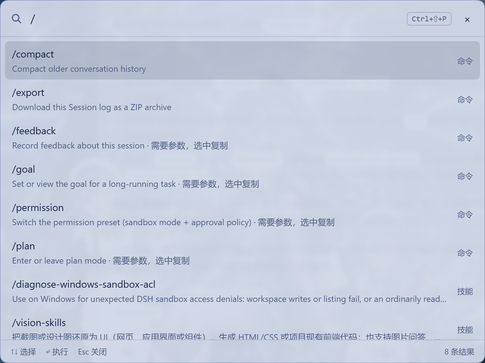

# dsh-kbar

DSH 的命令面板。按 `Ctrl+Shift+P`（macOS `Cmd+Shift+P`）打开，输入关键字，回车执行。



## 能做什么

| 输入 | 结果 | 回车后 |
| --- | --- | --- |
| 会话标题里的词 | 匹配的会话 | 打开该会话 |
| `flash`、`pro` | 当前会话可用的模型 | 切换模型 |
| 插件名的一部分 | 已安装的插件 | 打开插件详情页 |
| 技能名的一部分 | 当前工作区的技能 | 复制 `/技能名` |
| `新建`、`插件` | 内置动作 | 新建会话 / 打开插件页 |
| 命令名的一部分 | DSH 快捷键命令 | 执行该命令 |
| `/compact`、`/export` 等 | 当前会话的斜杠命令 | 直接执行；需要参数的命令复制 `/name ` |

`↑`/`↓` 选择，`Enter` 执行，`Esc` 关闭；右上角 `×` 也能关。

除了快捷键，侧边栏底部也有「打开命令面板」入口，点一下就开。

`Ctrl+K` 是 DSH 自带的会话搜索，所以这里用 `Ctrl+Shift+P`。想换键位：设置 → 快捷键。

## 安装

```sh
# npm
dsh plugin --profile web add dsh-kbar

# GitHub
dsh plugin --profile web add "git+https://github.com/adengou/dsh-kbar.git"

# Gitee
dsh plugin --profile web add "git+https://gitee.com/adengou/dsh-kbar.git"
```

DSH 桌面版在 设置 → 插件 里安装。

## 常见问题

- **按 `Ctrl+Shift+P` 没反应**：确认插件已启用；桌面端先按一次 `Ctrl+F5`；再到 设置 → 快捷键 看 `kbar.open` 是否被改键或冲突。
- **侧边栏没有入口**：刷新或重启应用；侧边栏收起时显示为放大镜图标。
- **搜不到插件或技能**：插件和技能目录在面板打开后要一两秒加载；技能按当前工作区返回。
- **和 `Ctrl+K` 重复吗**：会话搜索确实和官方重叠，但面板还能搜模型、插件、技能、动作和快捷键命令；只想搜会话就直接按 `Ctrl+K`。
- **面板能拖动吗**：不能，固定居中。拖动版本有 BUG，已移除。

## 许可

MIT License，版权归 adengou。完整文本见 [LICENSE](LICENSE)。
